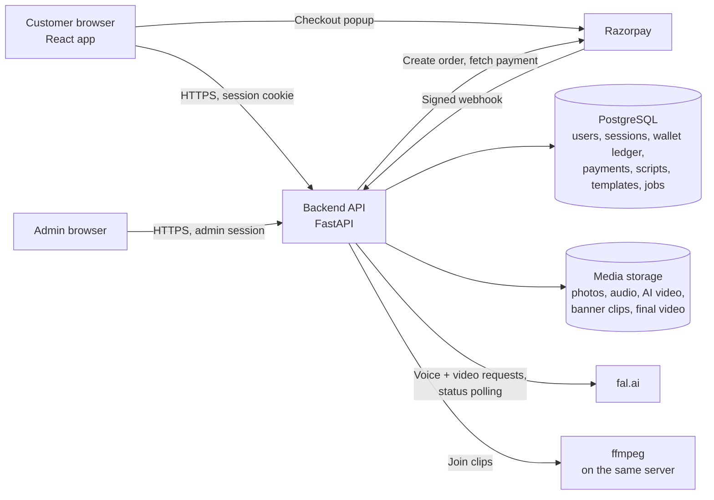
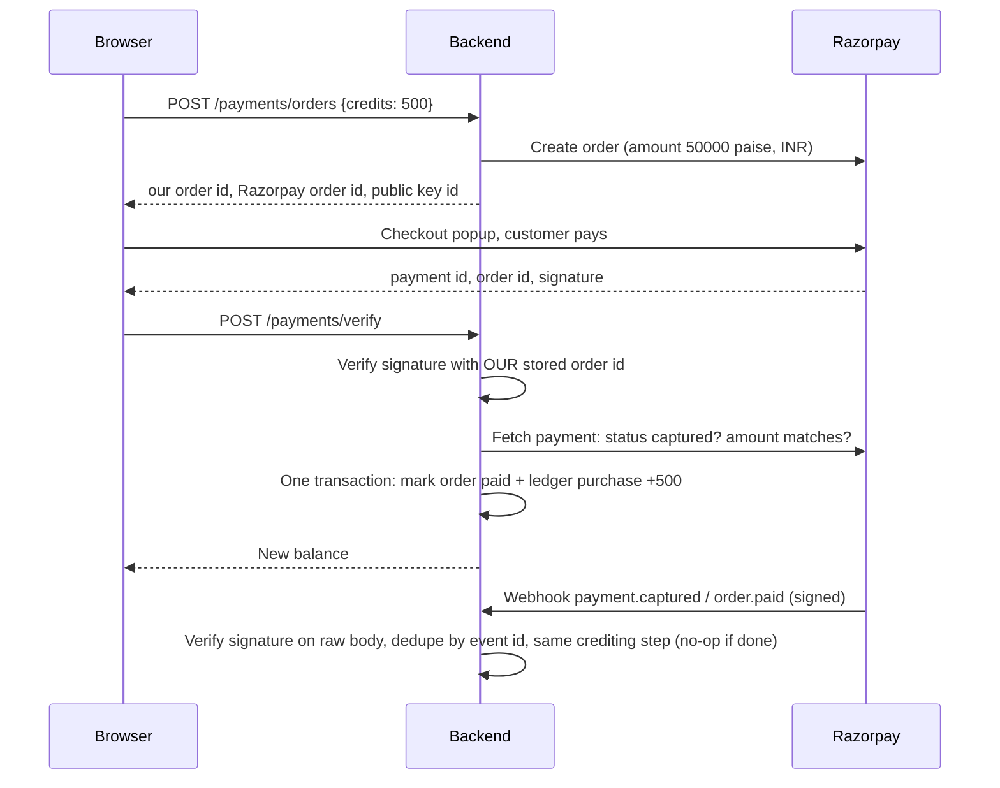

# High-Level Design — Talking Avatar Platform

Status: **Proposed, awaiting owner approval** (revised 2026-11-17). Nothing in this document is
built unless the section "What exists today" says so.

Related documents: [DECISIONS.md](DECISIONS.md) (why each choice was made),
[MILESTONES.md](MILESTONES.md) (build order, gates and acceptance criteria),
[tracker/](tracker/) (current status of every task, question and requirement).

Governing rules: the parent [CLAUDE.md](../CLAUDE.md). Where this design and that file disagree,
that file wins and this design is corrected.

## 1. What we are building

A customer signs up, logs in, buys credits through Razorpay (₹1 = 1 credit), and spends those
credits to generate talking-avatar videos. They paste a script or pick one they used before,
optionally choose a start banner and an end banner, listen to the voice, approve it, and receive
one video file: start banner, AI-generated video, end banner.

The videos are produced by fal.ai models, paid for from the company's own fal.ai balance. The
customer never deals with fal.ai; they only see their credit wallet.

**Scope note.** The parent CLAUDE.md calls the project a "POC". On 2026-11-17 the owner asked for
a paid, multi-user platform (requirement R-42). This design follows that wider scope and the
parent file's rule of minimal sufficient complexity: nothing here is added for scale we do not
have.

Two money systems are involved and they must not be confused:

| | Customer wallet | Company fal.ai balance |
| --- | --- | --- |
| Currency | Credits (₹1 = 1 credit) | US dollars |
| Who tops it up | The customer, through Razorpay | The company, on fal.ai's billing page |
| Where the record lives | Our database (the ledger) | fal.ai's account |
| Who is charged per video | The customer, at our price | The company, at fal.ai's price |

The difference between the two is the margin. The credit price per second is not decided
(question Q-01).

## 2. What exists today

Status: **MOCK-VERIFIED** on 2026-11-17. The 30 backend tests passed using the mock provider, and
the frontend type-checked. No fal.ai or Razorpay call was made. This is not evidence that the
live fal.ai integration works.

- **Backend** (`backend/`): FastAPI on Python 3.13+, managed with `uv`. One SQLite table of jobs.
  Files on local disk. A job moves through
  `audio_generating → audio_ready → video_submitting → video_generating → completed`, or to
  `failed`. Every move is a compare-and-set, which is what stops a job being paid for twice.
- **Providers**: `mock` (free, offline) and `fal` (paid). Voice: MiniMax, Kokoro, or Gemini TTS for
  Punjabi. Video: `fal-ai/kling-video/ai-avatar/v2/standard`.
- **ffmpeg**: used today only by the mock provider (to make a still-image video) and by `ffprobe`
  to measure audio length. Optional today.
- **Frontend** (`frontend/`): React 19, Vite 8, TypeScript 7. A single page with no routing, no
  login, and no tests.
- **Not present**: users, login, payments, wallet, script history, banners, video history, admin,
  deployment, CI.

The job state machine and its tests are the valuable part of the POC. The design keeps them and
adds users, money, scripts and banners around them (decision D-001).

## 3. System overview

One backend process serves the API, runs the poller that collects finished videos, and joins the
banners (D-009). PostgreSQL replaces SQLite (D-002). Media stays on local disk during development
(D-010).

### Backend modules (target layout)

| Module | Responsibility |
| --- | --- |
| `auth` | Sign-up, login, sessions, email verification, password reset, the "current user" dependency |
| `wallet` | The ledger: credit, hold, capture, release, adjust. The only code allowed to change a balance |
| `payments` | Razorpay orders, signature verification, webhooks, reconciliation |
| `scripts` | Each customer's script library |
| `templates` | The company's banner clips: add, list, retire |
| `jobs` | The existing lifecycle, now owned by a user, priced in credits, with the joining step |
| `providers` | fal.ai and mock (unchanged interface) |
| `media` | Measuring and joining video with ffmpeg; no paid calls |
| `admin` | Read views and audited manual adjustments |
| `core` | Settings, database session, error shape, logging, rate limiting |

### Customer app screens (target layout)

| Area | Screens |
| --- | --- |
| Auth | Sign up, log in, verify email, forgot and reset password |
| Home | Balance, "create a video", videos in progress, recent videos |
| Create | Photo → script (paste or pick) → banners (pick or none) → consent → listen and see the price → generating → joining → result |
| Scripts | "My scripts": list, reuse, delete |
| Videos | History list and a detail page |
| Wallet | Balance, buy credits (Razorpay Checkout), transaction history |
| Account | Profile, change password, log out everywhere |
| Admin | Users, payments, ledger, manual adjustment, templates (admins only; optional screens, see MILESTONES M6) |

## 4. Data model

All money columns are integers: credits as whole credits, rupee amounts in paise. No floats (D-014).

| Table | Key columns | Notes |
| --- | --- | --- |
| `users` | id, email (unique, case-insensitive), password_hash, email_verified_at, role (`user`/`admin`), status | |
| `sessions` | id, user_id, token_hash, expires_at, revoked_at | Only the hash of the session token is stored |
| `email_tokens` | id, user_id, purpose (`verify`/`reset`), token_hash, expires_at, used_at | Single use |
| `wallets` | user_id, balance_credits, reserved_credits | `CHECK (reserved_credits >= 0 AND balance_credits >= reserved_credits)` |
| `ledger_entries` | id, user_id, kind, credits, balance_after, reserved_after, ref_type, ref_id, created_by, created_at | Append-only. `UNIQUE (kind, ref_type, ref_id)` |
| `payment_orders` | id, user_id, razorpay_order_id (unique), amount_paise, credits, status, razorpay_payment_id (unique) | |
| `webhook_events` | event_id (primary key), event_type, payload, received_at, processed_at | Dedupes Razorpay deliveries |
| `scripts` | id, user_id, language, text, text_hash, created_at, last_used_at, deleted_at | One live row per `(user_id, language, text_hash)` |
| `templates` | id, name, kind (`start`/`end`), clip_file, preview_file, duration_ms, has_audio, active, created_by | Company-supplied. Retired, never deleted, so past jobs keep their reference |
| `jobs` | existing columns + user_id, script_id, start_template_id, end_template_id, price_credits, ai_video_file, banners_applied, assembly_attempts, consent_version, consent_at, needs_review | `script` (the text) stays on the job as its own copy |
| `audit_log` | id, actor_user_id, action, target, detail, created_at | Admin actions and security events |

Available credits = `balance_credits − reserved_credits`.

### Ledger entry kinds

| Kind | Effect on balance | Effect on reserved | Written when |
| --- | --- | --- | --- |
| `purchase` | +N | — | A Razorpay payment is confirmed |
| `hold` | — | +N | The customer approves the audio |
| `capture` | −N | −N | The video is delivered |
| `release` | — | −N | The AI video fails, times out, or is refused |
| `adjustment` | ±N | — | An admin corrects a balance (audited, reason required) |
| `refund` | −N | — | A Razorpay payment is refunded |

The uniqueness rule on `(kind, ref_type, ref_id)` means a payment can be credited once and a job
can be held, captured or released once, even if the request, the webhook, or the poller runs twice.

## 5. Key flows

### 5.1 Buying credits

Rules, each traced to Razorpay's documentation (checked 2026-11-17):

- The amount is sent in paise. ₹500 is `50000`.
- The checkout signature is `HMAC-SHA256(order_id + "|" + payment_id, key_secret)`, computed with
  the order id **stored on our server**, not the one the browser sends back.
- The webhook signature is HMAC-SHA256 of the **raw** request body with the webhook secret, sent in
  `X-Razorpay-Signature`. The body must not be parsed before verification.
- Razorpay may deliver the same webhook more than once and out of order. Deliveries are deduped on
  the `x-razorpay-event-id` header.
- A `payment.failed` can be followed by a `payment.captured` for the same order (common with UPI),
  so a failed event never closes an order permanently.
- Credits are granted only when the payment status is `captured` and the amount equals the order
  amount. The browser's word is never enough.
- If the customer closes the tab before `/payments/verify` runs, the webhook still credits them. If
  the webhook is also missed, a reconciliation task asks Razorpay about orders still marked
  `created` after a few minutes.

### 5.2 Generating a video and charging for it

| Step | Job status change | Wallet action | One database transaction? |
| --- | --- | --- | --- |
| Customer submits photo, script and banner choice | → `audio_generating` | Check available credits cover the estimated price. No hold | — |
| Voice is ready | → `audio_ready` | Price fixed: `ceil(audio seconds × rate)`, shown to the customer | — |
| Customer approves | `audio_ready` → `video_submitting` | `hold` the price. Refuse with HTTP 402 if not enough credits | Yes |
| Upload to fal.ai fails, or fal.ai definitely refuses | → `audio_ready` | `release` | Yes |
| Submission outcome unknown (timeout, crash mid-call) | → `failed`, flagged for review | `release` (the customer got nothing; see Q-19) | Yes |
| fal.ai accepts | → `video_generating` | Hold stays | — |
| AI video downloaded, no banners chosen | → `completed` | `capture` | Yes |
| AI video downloaded, banners chosen | → `video_assembling` | Hold stays | — |
| Joining succeeds | → `completed` | `capture` | Yes |
| Joining fails after retries | → `completed` without banners, flagged for review | `capture` (the paid AI video is delivered; see Q-17) | Yes |
| AI video fails or times out | → `failed` | `release` | Yes |

The invariant: **a job's status change and its ledger entry commit together or not at all.**

Voice generation is not charged separately (D-015). A job can only be started when the wallet
covers the estimated price, and each user has a daily cap on voice generations.

### 5.3 Script library

- On the Create screen the customer pastes a script or picks one from "My scripts".
- A pasted script is saved to the library when the job is created. If the same customer has
  already saved identical text in the same language, no new row is made; "last used" is updated.
- The job stores its own copy of the text. Deleting a saved script, or the library changing
  later, never alters a past video (D-017).
- The existing checks still apply to every script, saved or pasted: length limit, language, and
  the rule that refuses a script written in another language's alphabet.
- A customer sees only their own scripts.

### 5.4 Banners and joining

- A template is a short video clip, about 2 to 3 seconds, of kind `start` or `end`. The company
  supplies them (D-018). When a clip is added it is measured with `ffprobe`; anything that is not
  a playable video within the length limit is refused. The length limit is a setting.
- The customer chooses a start banner, an end banner, both or neither, with playable previews.
  The choice can change until the audio is approved.
- After the AI video is downloaded, the `video_assembling` step:
  1. measures the AI video's picture size, frame rate and sound format;
  2. converts each chosen clip to match, adding silence if the clip has no sound;
  3. joins start clip + AI video + end clip into one MP4.
- The AI video itself is kept as `ai_video_file`; the joined file is what the customer downloads.
- Joining calls no paid service. It is therefore **safe to retry**, unlike a fal.ai submission: a
  failed attempt is retried, and a job found in `video_assembling` after a restart is run again.
- Banner seconds add nothing to the price (D-020).

## 6. API surface (proposed)

All routes sit under `/api/v1`. The existing `/api/...` routes move there in milestone M1.
Errors use one shape: `{"detail": "<message for the user>", "code": "<machine_code>"}`.

Contract-first: each milestone from M2 starts with a task that writes that milestone's routes
into the OpenAPI document before backend or frontend work begins.

| Area | Routes |
| --- | --- |
| Auth | `POST /auth/signup`, `POST /auth/login`, `POST /auth/logout`, `GET /auth/me`, `POST /auth/verify-email`, `POST /auth/password/forgot`, `POST /auth/password/reset` |
| Wallet | `GET /wallet`, `GET /wallet/transactions` |
| Payments | `POST /payments/orders`, `POST /payments/verify`, `POST /webhooks/razorpay` |
| Scripts | `GET /scripts`, `GET /scripts/{id}`, `DELETE /scripts/{id}` |
| Templates | `GET /templates`, `GET /templates/{id}/preview` |
| Jobs | `POST /jobs` (script text **or** script id; optional start and end template ids), `GET /jobs`, `GET /jobs/{id}`, `POST /jobs/{id}/approve`, `GET /jobs/{id}/audio`, `GET /jobs/{id}/video` |
| Config | `GET /config` (limits, languages, credit rate) |
| Admin | `GET /admin/users`, `GET /admin/payments`, `GET /admin/ledger`, `POST /admin/wallets/{user_id}/adjust`, `POST /admin/templates`, `PATCH /admin/templates/{id}` |
| Ops | `GET /healthz` |

Frontend types are generated from the OpenAPI document (D-011), so the two cannot drift silently.

## 7. Security and privacy

| Concern | Design |
| --- | --- |
| Passwords | Argon2id hashes. Never logged |
| Sessions | Random opaque token in an `HttpOnly`, `Secure`, `SameSite=Lax` cookie. Hash stored server-side, so a session can be revoked |
| Cross-site requests | `SameSite` cookie plus an `Origin` check on every state-changing request |
| Access control | Every job, media file, script, wallet and payment query is filtered by the logged-in user. Another user's resource returns 404 |
| Brute force | Rate limits on login, sign-up, password reset and voice generation |
| Uploads | Photos are re-encoded, as the POC does today. Banner clips come only from admins and are measured before being accepted |
| Scripts | Personal content: same access rule and retention policy as photos; never written to logs |
| Payments | No card data touches our servers; Razorpay Checkout handles it. Secrets only in environment variables |
| Webhooks | Signature verified on the raw body before anything else. Unsigned requests get 400 and are not stored |
| Likeness consent | A required checkbox per job; the consent text version and time are stored on the job (wording: Q-11) |
| AI disclosure | The interface labels every output as AI-generated |
| Audit | Admin actions, template changes, logins, password changes and balance adjustments go to `audit_log` |
| Secrets | `FAL_KEY`, Razorpay key secret, webhook secret, session secret: environment only, never committed, never sent to the browser |

## 8. Failure and recovery

| Failure | Behaviour |
| --- | --- |
| Backend restarts during video generation | Existing: the poller resumes by fal.ai request id |
| Backend restarts during a paid submission | Existing: job fails, never retried. New: the hold is released |
| Backend restarts during joining | The joining step runs again; it costs nothing to repeat |
| Joining keeps failing | The customer gets the AI video without banners, is charged, and is told; the job is flagged |
| A chosen template is retired before the job finishes | The job still uses it; retiring only hides it from new choices |
| Customer pays but closes the tab | Webhook credits the wallet |
| Webhook never arrives | Reconciliation asks Razorpay about stale orders |
| Webhook arrives twice | Second delivery is a no-op (event id + ledger uniqueness) |
| Two approvals at the same instant | One wins the compare-and-set; the other gets 409. One hold |
| Two purchases or approvals racing on one wallet | The wallet row is locked for the transaction; the `CHECK` constraint is the last line of defence |
| fal.ai balance runs out | fal.ai refuses the request; the hold is released; the customer sees "temporarily unavailable" |

## 9. What this design does not include

Deferred (documented, not built now): self-service refunds, credit expiry, teams and
organisations, coupons, more languages, AI videos longer than 30 seconds, regenerating a voice or
video, cancelling a generation, customer-uploaded or customised banners, editing or sharing saved
scripts, a mobile app, running several backend instances, single sign-on.

Out of scope: converting credits back to money, payment gateways other than Razorpay.

## 10. Verification status of external facts

Where a row says "Not verified", the full statement from the parent CLAUDE.md applies:
*Not verified — requires documentation review, execution, or live integration testing.*

| Fact | Status |
| --- | --- |
| Razorpay order amount in paise; checkout returns payment id, order id, signature; signature formula | Checked against Razorpay documentation 2026-11-17. Not run |
| Razorpay webhook signature on raw body; event id header for dedupe; ordering not guaranteed | Checked against Razorpay documentation 2026-11-17. Not run |
| Razorpay webhook retry schedule and required response time | Not verified. The page checked does not state them |
| Video model price $0.0562 per second of output; inputs are image URL + audio URL | Checked on the fal.ai model page 2026-11-17 |
| Video model limits on audio length and image size | Not verified. The model page does not state them |
| Video model output: picture size, frame rate, sound format | Not verified. The design measures each video instead of assuming |
| The model keeps the face consistent; output quality is acceptable | Not verified. Can only be judged from live output, against criteria the owner has yet to set (Q-18) |
| How fal.ai reports and bills failed generations | Not verified |
| fal.ai result links expire | Not verified. Not relied on: files are downloaded at once |
| fal.ai offers a balance or usage API | Not verified. Not found on the page checked |
| fal.ai queue webhooks exist, signed with ED25519 | Checked 2026-11-17; not used in this design (D-008) |
| MiniMax voice works live | Recorded in `backend/app/config.py` as run on 2026-11-16; not re-run by this review |
| The video model works live end to end | Not verified. The README says the fal.ai integration has not been run live |
| Joining real model output with banner clips works | Not verified |
| GST treatment of credit sales; whether a closed wallet needs registration | Not verified. Needs an accountant and a lawyer (Q-03, Q-12) |
